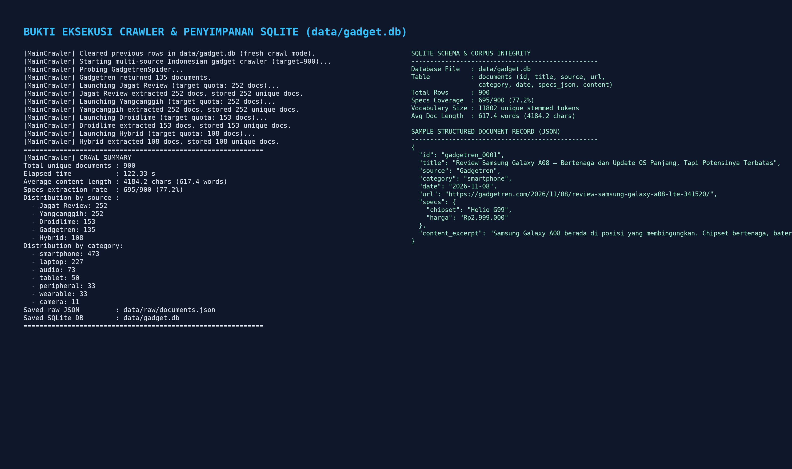

# BAB III Metode Penelitian

## 3.1 Lingkungan Implementasi

Sistem mesin pencari vertikal dibangun dalam arsitektur terpisah (decoupled client-server) yang dikontainerisasi menggunakan Docker Compose agar dapat direproduksi dengan satu perintah (`docker compose up --build`). Lingkungan implementasi terdiri dari komponen berikut:

1. Backend Service: Python 3.11 dengan framework FastAPI dan server ASGI Uvicorn. Modul inti mencakup prapemrosesan teks PySastrawi, mesin Okapi BM25, mesin Sentence-BERT (`sentence-transformers`, `torch`, `numpy`), serta modul evaluasi `IREvaluator`.
2. Frontend Service: Aplikasi web Single-Page Application berbasis React 18, Vite, Tailwind CSS, Lucide Icons, dan Recharts yang disajikan pada port `3000`. Fitur utama mencakup tampilan komparasi hasil pencarian berdampingan (Side-by-Side Split View), modal detail spesifikasi teknis, dan Dasbor Evaluasi interaktif.
3. Storage Layer: Database SQLite (`data/gadget.db`) untuk penyimpanan dokumen terstruktur, arsip JSON mentah (`data/raw/documents.json`), Inverted Index JSON (`data/processed/inverted_index.json`), serta matriks embedding NumPy (`data/processed/embeddings.npy`).
4. Pengujian & Verifikasi Otomatis: Suite pengujian Python (`pytest`, 161 unit test) dan frontend (`vitest`) yang dijalankan secara otomatis pada GitHub Actions CI serta skrip gatekeeper `scripts/verify_pipeline.py`.

## 3.2 Arsitektur Sistem

Alur kerja sistem dari pengumpulan data hingga evaluasi terdiri dari lima tahap berurutan:

Crawling -> Preprocessing -> Indexing -> Retrieval -> Evaluation

1. Crawling: Modul `crawler/main_crawler.py` mengeksekusi lima spider portal teknologi Indonesia, membersihkan markup HTML, mengekstrak spesifikasi teknis, mengklasifikasikan kategori gadget dengan pencocokan regex berbatas kata (word-boundary), dan memfilter artikel non-gadget.
2. Preprocessing: Gabungan judul dan isi artikel dibersihkan, ditokenisasi, disaring stopword-nya, dan di-stem menjadi kata dasar menggunakan `IndonesianPreprocessor` (PySastrawi).
3. Indexing: Tahap luring (`backend/app/engine/indexer.py`) membangun Inverted Index untuk Okapi BM25 dan menghasilkan vektor embedding 384 dimensi ternormalisasi L2 untuk Sentence-BERT.
4. Retrieval: Pengguna mengirimkan kueri melalui antarmuka React ke endpoint `/api/search`. Backend mengembalikan peringkat Top-K dari Okapi BM25 dan Sentence-BERT beserta skor relevansi dan latensi eksekusi masing-masing secara berdampingan.
5. Evaluation: Modul `backend/app/engine/evaluator.py` menjalankan 15 kueri uji terhadap ground truth untuk menghitung Precision@K, Recall@K, F1-Score, MAP, dan latensi, lalu mengekspor hasilnya ke `evaluation_results/metrics_summary.json` dan `evaluation_results/per_query_benchmark.csv`.

## 3.3 Multi-source Crawler

Untuk membangun korpus ulasan gadget yang beragam, mutakhir, dan representatif terhadap ekosistem media teknologi Indonesia, crawler dirancang secara modular dengan `BaseSpider` (`crawler/spiders/base.py`) dan subclass khusus `WPJsonSpider` (`crawler/spiders/wp_rest.py`). Korpus dikumpulkan dari lima portal teknologi Indonesia:

1. Jagat Review (`jagatreview.py`, kuota 28% / 252 dokumen): Menggunakan WordPress REST API v2 resmi pada kategori Notebook/Laptop (ID 46) dan Gadget/Smartphone (ID 38).
2. Yangcanggih (`yangcanggih.py`, kuota 28% / 252 dokumen): Menggunakan WordPress REST API v2 pada kategori Review khusus (ID 569) yang kaya akan tabel spesifikasi terstruktur.
3. Droidlime (`droidlime.py`, kuota 17% / 153 dokumen): Menggunakan WordPress REST API v2 secara berurutan pada kategori Review, Hands-on, Harga HP, dan Fitur.
4. Gadgetren (`gadgetren.py`, kuota 15% / 135 dokumen): Melakukan ekstraksi HTML halaman review beserta deteksi tanggal publikasi ISO dari tag `<time>`, meta OpenGraph, dan pola URL, serta penanganan aman terhadap respons HTTP 403 tanpa melewati batasan situs.
5. Hybrid (`hybrid.py`, kuota 12% / 108 dokumen): Menggunakan WordPress REST API v2 pada kategori Gadget dan Gadget DS dengan filter ketat untuk menyaring hanya artikel ulasan/fitur perangkat keras substantif (minimal 900 karakter) dan mengecualikan berita turnamen esports.

Setiap artikel melalui pembersihan DOM HTML (penghapusan skrip, widget berbagi, tautan "Baca juga", serta elemen iklan), validasi domain gadget untuk menyingkirkan topik di luar cakupan (film, kursi gaming, gim konsol, atau promo tarif seluler), serta ekstraksi spesifikasi teknis ke dalam skema kanonik (`chipset`, `prosesor`, `gpu`, `ram`, `storage`, `layar`, `kamera`, `baterai`, `os`, `harga`) melalui parser tabel HTML, daftar berlabel, dan pola regex. Nilai spesifikasi yang diekstrak tetapi belum tertulis persis di paragraf isi ditambahkan sebagai ringkasan teks di akhir konten agar dapat diindeks oleh BM25 maupun Sentence-BERT. Deduplikasi lintas portal berbasis URL ternormalisasi dan judul menjamin seluruh 900 dokumen dalam korpus bersifat unik.

## 3.4 Skema Database SQLite

Seluruh dokumen hasil crawling disimpan ke dalam file JSON terpadu (`data/raw/documents.json`) dan database relasional SQLite (`data/gadget.db`) pada tabel `documents` dengan indeks pada kolom `source` dan `category`. Struktur kolom tabel `documents` adalah sebagai berikut:

| Kolom | Tipe Data | Keterangan |
| :--- | :--- | :--- |
| `id` | `TEXT PRIMARY KEY` | Identifikasi unik dokumen (`<sumber>_<nomor_urut>`, misalnya `jagatreview_0001`). |
| `title` | `TEXT NOT NULL` | Judul artikel ulasan yang telah dibersihkan dari entitas HTML. |
| `source` | `TEXT NOT NULL` | Nama portal sumber (`Jagat Review`, `Yangcanggih`, `Droidlime`, `Gadgetren`, `Hybrid`). |
| `url` | `TEXT NOT NULL` | Tautan asli artikel untuk verifikasi dan rujukan langsung dari antarmuka web. |
| `category` | `TEXT NOT NULL` | Kategori gadget hasil klasifikasi berbatas kata (`smartphone`, `laptop`, `audio`, `tablet`, `peripheral`, `wearable`, `camera`). |
| `date` | `TEXT` | Tanggal publikasi artikel dalam format ISO `YYYY-MM-DD`. |
| `specs_json` | `TEXT` | Objek JSON berisi spesifikasi teknis terekstrak untuk ditampilkan sebagai chip dan modal detail. |
| `content` | `TEXT NOT NULL` | Teks ulasan bersih berbahasa Indonesia beserta ringkasan spesifikasi utama. |

## 3.5 Ground Truth Labeling

Untuk mengevaluasi performa penelusuran secara objektif dan bebas bias terhadap salah satu algoritma, disusun 15 kueri uji (`data/ground_truth/test_queries.json`) yang terbagi seimbang menjadi dua kelompok:

1. Delapan kueri teknis eksak (`q01`–`q08`): Mewakili pencarian spesifikasi perangkat, merek, atau model tertentu, antara lain `"Xiaomi kamera Leica"`, `"ASUS Zenbook Intel OLED"`, `"smartwatch layar AMOLED baterai awet"`, `"laptop gaming NVIDIA RTX"`, `"smartphone chipset Snapdragon 8"`, `"layar AMOLED 120Hz fast charging"`, `"Samsung Galaxy Z Fold"`, dan `"smartphone MediaTek Dimensity 5G"`.
2. Tujuh kueri semantik berbasis niat (`q09`–`q15`): Mewakili kebutuhan pengguna dalam bahasa alami tanpa menyebut kode komponen spesifik, meliputi `"smartphone fotografi malam hari minim cahaya"`, `"laptop tipis dan ringan untuk kerja mahasiswa"`, `"HP baterai tahan lama seharian tanpa sering cas"`, `"laptop layar akurat untuk editing video kreator"`, `"smartphone gaming kencang harga terjangkau"`, `"tablet layar luas untuk produktivitas dan hiburan"`, dan `"earbuds TWS peredam bising suara jernih"`.

Penentuan relevansi biner pada `data/ground_truth/relevance_judgments.json` menggunakan metode TREC-style pooling: kandidat dokumen untuk setiap kueri dihimpun dari gabungan Top-15 hasil Okapi BM25, Top-15 hasil Sentence-BERT, dan hingga 10 kecocokan kata kunci SQLite pada judul dan spesifikasi, kemudian diperiksa secara manual kesesuaian topik serta spesifikasinya. Setiap kueri memiliki antara 8 hingga 15 dokumen relevan yang terverifikasi keberadaannya di `data/gadget.db`.

## 3.6 Prosedur Evaluasi

Evaluasi dilakukan dengan menjalankan `python3 -m backend.app.engine.evaluator` di dalam lingkungan container Linux Docker terhadap indeks penuh 900 dokumen dan model asli `paraphrase-multilingual-MiniLM-L12-v2`. Untuk setiap kueri uji, sistem mencatat sepuluh dokumen peringkat teratas beserta waktu eksekusi (`time.perf_counter()`), lalu menghitung metrik Precision@5, Precision@10, Recall@5, Recall@10, F1@5, F1@10, Average Precision (AP), serta agregat makro MAP dan rata-rata latensi. Selain rata-rata latensi total, dicatat pula rata-rata latensi steady-state (`q02`–`q15`) guna memisahkan biaya inisialisasi awal model (cold-start loading pada kueri pertama) dari kecepatan inferensi murni per kueri.
