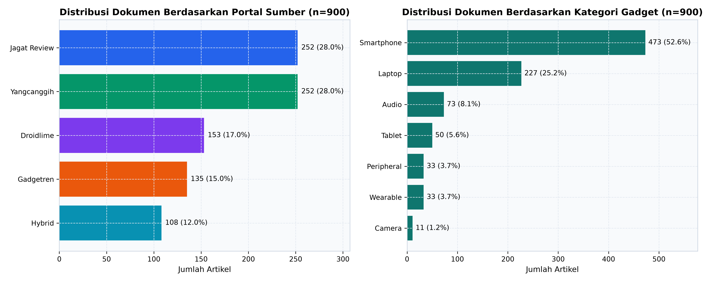
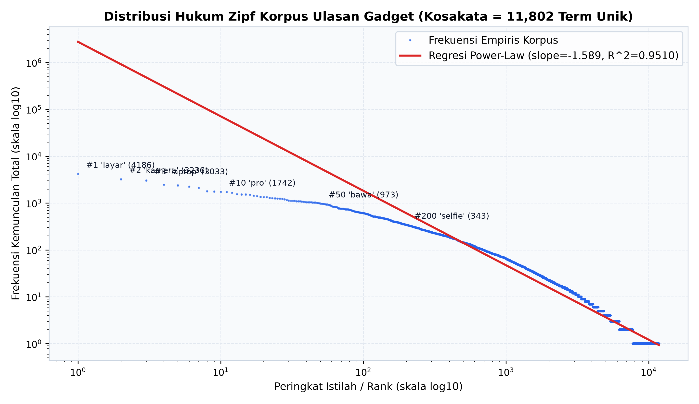
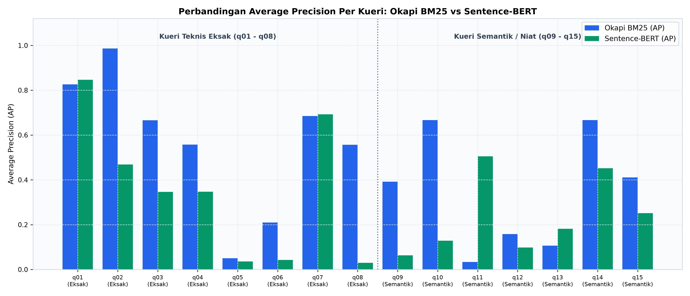
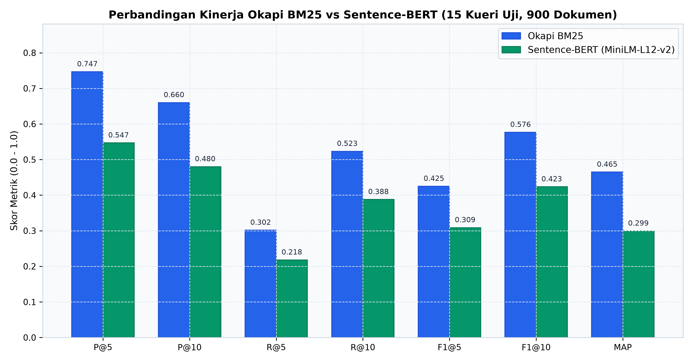
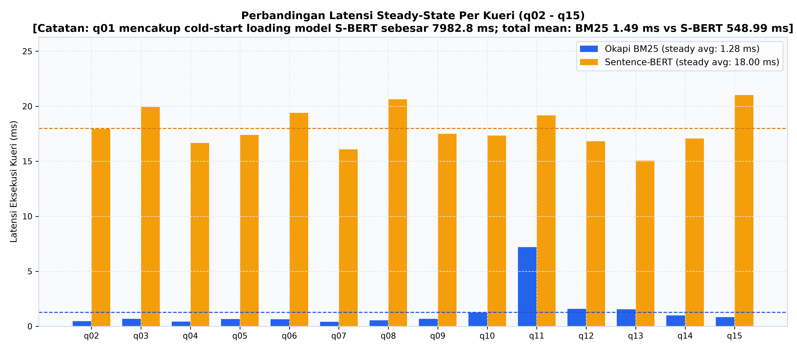

# BAB IV Hasil dan Pembahasan

## 4.1 Analisis Karakteristik Korpus

Korpus yang berhasil dikumpulkan oleh crawler multi-sumber terdiri dari **900 artikel ulasan gadget unik** berbahasa Indonesia yang dihimpun dalam waktu 122,33 detik dari lima portal teknologi Indonesia. Rata-rata panjang dokumen mentah adalah **617,43 kata** (4.184,20 karakter) dengan median 647 kata dan rentang 131 hingga 749 kata. Dari seluruh korpus, sebanyak **695 dokumen (77,22%)** memiliki spesifikasi teknis terstruktur yang berhasil diekstrak ke kolom `specs_json`, meliputi atribut `ram` (338 dokumen), `harga` (316), `chipset` (261), `kamera` (173), `baterai` (172), `storage` (168), `prosesor` (139), `layar` (132), `gpu` (92), dan `os` (44).

Tabel 4.1 menunjukkan sebaran dokumen berdasarkan portal sumber serta kategori perangkat.

| Portal Sumber | Jumlah Artikel | Persentase | Kategori Gadget | Jumlah Artikel | Persentase |
| :--- | :---: | :---: | :--- | :---: | :---: |
| Jagat Review | 252 | 28,0% | Smartphone | 473 | 52,6% |
| Yangcanggih | 252 | 28,0% | Laptop | 227 | 25,2% |
| Droidlime | 153 | 17,0% | Audio | 73 | 8,1% |
| Gadgetren | 135 | 15,0% | Tablet | 50 | 5,6% |
| Hybrid | 108 | 12,0% | Peripheral | 33 | 3,7% |
| **Total Korpus** | **900** | **100,0%** | Wearable | 33 | 3,7% |
| | | | Camera | 11 | 1,2% |

## 4.2 Distribusi Kata (Hukum Zipf)

Setelah melalui tahap case folding, tokenisasi, penghapusan stopword, dan stemming dengan PySastrawi, korpus menghasilkan **11.802 token dasar unik** pada Inverted Index dengan rata-rata panjang dokumen terindeks (`avgdl`) sebesar **388,89 token**. Analisis peringkat terhadap frekuensi kemunculan istilah memperlihatkan kesesuaian kuat dengan Hukum Zipf, dengan gradien regresi power-law pada skala log-log sebesar **-1,5891** dan koefisien determinasi **$R^2 = 0{,}9510$**. Sejumlah kecil kata domain muncul sangat sering, sedangkan mayoritas istilah teknis spesifik (seperti seri prosesor atau nomor model) muncul jauh lebih jarang sehingga memperoleh bobot diskriminasi IDF yang tinggi pada Okapi BM25.

Tabel 4.2 menyajikan sepuluh istilah dasar dengan frekuensi kemunculan tertinggi di korpus terindeks.

| Peringkat | Istilah Dasar (Stemmed) | Frekuensi Total | Peringkat | Istilah Dasar (Stemmed) | Frekuensi Total |
| :---: | :--- | :---: | :---: | :--- | :---: |
| 1 | `layar` | 4.186 | 6 | `fitur` | 2.243 |
| 2 | `kamera` | 3.236 | 7 | `warna` | 2.105 |
| 3 | `laptop` | 3.033 | 8 | `desain` | 1.777 |
| 4 | `2` | 2.481 | 9 | `dukung` | 1.765 |
| 5 | `smartphone` | 2.373 | 10 | `pro` | 1.742 |

## 4.3 Pengujian Kueri Eksak vs Kueri Semantik

Pengujian dilakukan terhadap 15 kueri uji yang mencakup 8 kueri teknis eksak (`q01`–`q08`) dan 7 kueri semantik berbasis niat (`q09`–`q15`). Tabel 4.3 merangkum performa per kueri antara Okapi BM25 dan Sentence-BERT.

| ID | Kueri Uji | Jenis | Rel | P@5 BM25 | P@5 S-BERT | AP BM25 | AP S-BERT |
| :--- | :--- | :--- | :---: | :---: | :---: | :---: | :---: |
| `q01` | Xiaomi kamera Leica | Eksak | 9 | 1,0000 | 1,0000 | 0,8261 | 0,8468 |
| `q02` | ASUS Zenbook Intel OLED | Eksak | 8 | 1,0000 | 0,4000 | 0,9861 | 0,4688 |
| `q03` | smartwatch layar AMOLED baterai awet | Eksak | 11 | 1,0000 | 0,6000 | 0,6662 | 0,3460 |
| `q04` | laptop gaming NVIDIA RTX | Eksak | 14 | 1,0000 | 0,6000 | 0,5571 | 0,3474 |
| `q05` | smartphone chipset Snapdragon 8 | Eksak | 15 | 0,2000 | 0,2000 | 0,0500 | 0,0356 |
| `q06` | layar AMOLED 120Hz fast charging | Eksak | 13 | 0,6000 | 0,2000 | 0,2098 | 0,0427 |
| `q07` | Samsung Galaxy Z Fold | Eksak | 13 | 1,0000 | 1,0000 | 0,6846 | 0,6923 |
| `q08` | smartphone MediaTek Dimensity 5G | Eksak | 15 | 0,8000 | 0,2000 | 0,5570 | 0,0300 |
| `q09` | smartphone fotografi malam hari minim cahaya | Semantik | 15 | 0,8000 | 0,4000 | 0,3921 | 0,0633 |
| `q10` | laptop tipis dan ringan untuk kerja mahasiswa | Semantik | 15 | 1,0000 | 0,4000 | 0,6667 | 0,1286 |
| `q11` | HP baterai tahan lama seharian tanpa sering cas | Semantik | 15 | 0,2000 | 0,8000 | 0,0333 | 0,5047 |
| `q12` | laptop layar akurat untuk editing video kreator | Semantik | 15 | 0,4000 | 0,4000 | 0,1582 | 0,0978 |
| `q13` | smartphone gaming kencang harga terjangkau | Semantik | 11 | 0,4000 | 0,4000 | 0,1061 | 0,1818 |
| `q14` | tablet layar luas untuk produktivitas dan hiburan | Semantik | 15 | 1,0000 | 1,0000 | 0,6667 | 0,4519 |
| `q15` | earbuds TWS peredam bising suara jernih | Semantik | 15 | 0,8000 | 0,6000 | 0,4107 | 0,2511 |

## 4.4 Tabel Komparasi Evaluasi Kuantitatif

Agregat makro kinerja kedua algoritma di seluruh 15 kueri uji terhadap 900 dokumen disajikan pada Tabel 4.4.

| Metrik Evaluasi | Okapi BM25 | Sentence-BERT (`MiniLM-L12-v2`) |
| :--- | :---: | :---: |
| Precision@5 | 0,7467 | 0,5467 |
| Precision@10 | 0,6600 | 0,4800 |
| Recall@5 | 0,3015 | 0,2180 |
| Recall@10 | 0,5231 | 0,3878 |
| F1-Score@5 | 0,4249 | 0,3086 |
| F1-Score@10 | 0,5765 | 0,4235 |
| Mean Average Precision (MAP) | 0,4647 | 0,2993 |
| Latensi rata-rata total `q01`-`q15` (ms) | 1,49 | 548,99 |
| Latensi steady-state `q02`-`q15` (ms) | 1,28 | 18,00 |

Catatan pada pengukuran latensi: nilai rata-rata total Sentence-BERT sebesar 548,99 ms dipengaruhi oleh *cold-start loading* bobot model `paraphrase-multilingual-MiniLM-L12-v2` saat kueri pertama (`q01`) dievaluasi selama 7.982,79 ms. Setelah model berada di memori (`q02`–`q15`), latensi inferensi per kueri Sentence-BERT stabil pada kisaran 15,07 hingga 21,02 ms (rata-rata 18,00 ms), dibandingkan Okapi BM25 yang rata-rata hanya membutuhkan 1,28 ms.

## 4.5 Analisis Kelebihan dan Kelemahan BM25 vs Sentence-BERT

Berdasarkan hasil pengujian pada 900 dokumen ulasan riil, terdapat tiga temuan utama yang menjelaskan perilaku komplementer kedua algoritma:

1. Keunggulan Okapi BM25 pada dokumen panjang dan spesifikasi teknis (`q02`, `q03`, `q04`, `q08`, `q10`, `q14`):
   Okapi BM25 mencapai MAP keseluruhan 0,4647 berbanding 0,2993 milik Sentence-BERT, serta menonjol pada kueri teknis seperti `q02` ("ASUS Zenbook Intel OLED", AP 0,9861 berbanding 0,4688) dan `q08` ("smartphone MediaTek Dimensity 5G", AP 0,5570 berbanding 0,0300). Penyebab utamanya adalah arsitektur transformer `paraphrase-multilingual-MiniLM-L12-v2` membatasi panjang masukan maksimal pada **128 token**. Padahal, rata-rata panjang ulasan gadget mencapai 617,43 kata dan ringkasan spesifikasi terekstrak berada di bagian akhir teks. Akibat pemotongan (truncation) setelah 128 token awal, rincian chipset, kapasitas charging, maupun pengujian kamera malam di tengah artikel tidak tercakup ke dalam embedding dokumen, sedangkan Inverted Index BM25 mengindeks seluruh token dokumen secara utuh.
2. Keunggulan Sentence-BERT dalam mengatasi polisemi dan ambiguitas leksikal (`q11`, `q13`, `q01`, `q07`):
   Pada `q11` ("HP baterai tahan lama seharian tanpa sering cas"), Okapi BM25 mengalami kegagalan akurasi (`P@5 = 0,2000`, `AP = 0,0333`) karena token `"hp"` berbenturan secara leksikal dengan ulasan laptop merek **HP** (Hewlett-Packard, seperti HP OmniBook dan HP EliteBook). Sebaliknya, Sentence-BERT memahami konteks kalimat Bahasa Indonesia bahwa "HP" yang dipasangkan dengan "baterai tahan lama seharian" merujuk pada smartphone berkapasitas baterai jumbo (`P@5 = 0,8000`, `P@10 = 0,9000`, `AP = 0,5047` — **15 kali lebih tinggi** daripada BM25). Keunggulan serupa terlihat pada `q13` ("smartphone gaming kencang harga terjangkau", AP 0,1818 vs 0,1061), `q01` (0,8468 vs 0,8261), dan `q07` (0,6923 vs 0,6846).
3. Kasus kegagalan token berfrekuensi tinggi (`q05`):
   Kedua algoritma memperoleh skor rendah pada `q05` ("smartphone chipset Snapdragon 8", AP 0,0500 untuk BM25 dan 0,0356 untuk S-BERT) karena angka `"8"` sangat umum muncul pada ribuan konteks lain (RAM 8GB, seri model 8, dll.), sementara banyak artikel yang menyebut varian Snapdragon seri 6 dan 7 ikut tertarik ke peringkat teratas.

Secara keseluruhan, Okapi BM25 unggul dalam kecepatan eksekusi (`1,28 ms` steady-state) dan presisi kecocokan kata kunci di dokumen ulasan panjang, sementara Sentence-BERT unggul dalam menangkap semantik dan menghindari jebakan polisemi istilah. Menyajikan hasil kedua mesin secara berdampingan memberikan nilai tambah nyata bagi pengguna.
